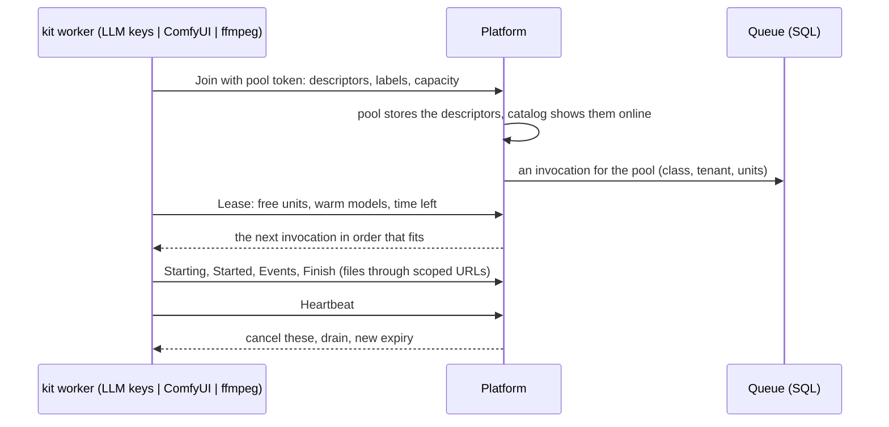

# Model layer

Status: the invocation contract and adapters in `model` and `model/chat`
(WP-L3-01), structured output and the call middleware in `model/structured`
and `model/middleware` (WP-L3-02), the catalog and price table in
`model/catalog` (WP-L3-06), the model node in `model/node` (WP-L3-03) and the
manifest-driven providers and router in `model/providers` (WP-L3-04) are
implemented. Decision: ADR-0006. Specs: `specs/models`.

## 1. One invocation contract

Every model call is an **invocation**, whatever the model does and however
its vendor answers. There is no separate synchronous and asynchronous API.

```go
type Invoker interface {
    Describe(ctx) ([]Descriptor, error)
    Start(ctx, Request) (Handle, error)                    // returns at once; idempotent per ClientRef
    Events(ctx, Handle, after int64) (<-chan Event, error) // ordered partial output: text, reasoning, tool calls, audio, progress, reset
    Result(ctx, Handle) (Result, error)                    // waits for the end
    Cancel(ctx, Handle) error
    Lookup(ctx, clientRef string) (*Handle, error)         // settle an ambiguous start
}
func Invoke(ctx, Invoker, Request) (Result, error)          // blocking form: Start + Result
```

| Vendor protocol | Adapter mapping | Typical capabilities |
| --- | --- | --- |
| `stream` (one request, streamed reply) | `Start` opens the stream; `Events` yields chunks; `Result` is the assembled reply | chat, streaming TTS |
| `single` (one request, one reply) | `Start` sends; `Result` returns the reply; no events | embeddings |
| `poll` | `Start` submits; `Events` reports progress from polling; `Result` when done | video, image, music |
| `webhook` | `Start` submits; the callback resolves the result | video, image |
| `socket` | `Start` submits; progress arrives over a WebSocket | generation servers |
| `command` | `Start` runs a local command; progress parsed from stdout; outputs are files | local tools and apps |

Why one contract: inside a run, a chat reply is just as asynchronous as a
video. It outlives the client connection, streams, can be cancelled, retried
and recorded. A single contract gives every model the same path for budget,
cancellation, reattach and replay. Small calls such as embeddings use the
blocking `Invoke` in process.

`model.Registry` holds what every adapter owes regardless of protocol:
idempotent starts per client ref within the tenant of the call's context, the
ordered event log with replay from a cursor, the result, cancellation and
lookup. It does not grow without bound: an ended invocation is kept for its
retention window after its end and no longer (1 hour by default), and while the
registry holds more ended invocations than its ended bound (10,000 by default)
it evicts them oldest-ended first, never a running one; an evicted client ref
then answers exactly as one the registry never held (REQ-MODEL-088). Both bounds
are set through `NewRegistry`'s options and read on a `core.Clock` the caller
supplies, and the sweep runs inline in the registry's methods: no timer, no
goroutine per invocation, and nothing in the gate depends on wall time. The chat
adapter (`model/chat`) and the embedding adapter (`model.NewEmbedding`) drive
eino models; `Request.Messages` and `Request.Tools` are JSON of `eino/schema`
values, so the contract itself stays free of the dependency. The chat adapter
caps one vendor stream at 8 MiB of payload and 262144 chunks; exceeding either
limit ends the invocation with `vendor_error`. The payload counts assistant text
and reasoning, every string of a tool call, the text and the URL or URI of legacy
multi-content parts, and the text, reasoning, URL, base64 data, file id and MIME
type of assistant-generated parts; Extra and ResponseMeta are metadata and are not
counted. A stream that ends with only vendor metadata
(`Extra`, `ResponseMeta` such as a content filter or refusal finish reason) and
no assistant content is `vendor_error` with a fixed message; provider adapters
map refusals to text or typed errors before that check. A vendor panic inside the
adapter's execute goroutine is converted to `internal` at that boundary without
crashing the process. Unmapped `Request.Params` keys (for example `tier` for
pricing) are ignored; the adapter maps `temperature`, `top_p`, `max_tokens` and
`stop`. Provider construction is WP-L3-04's, including the OpenAI-compatible
mode MiniMax and GLM use.

## 2. Descriptors

Every model has a `Descriptor`:
- capabilities (`chat`, `embed`, `image.*`, `video.*`, `audio.*`, `workflow.graph`, `browser.session`);
- a JSON Schema for its parameters;
- input slots (`messages`, `prompt`, `first_frame`, `reference[]`, `audio`, `mask`);
- a **CEL price formula**, in milli-points (§7);
- its vendor protocol;
- its locality: `cloud`; `machine_local`, which is never routed in the cloud
  profile; or `worker`, served by the workers of a pool (§6).

## 3. Providers

The generic HTTP and CLI drivers live in `model/providers`; a vendor is a
manifest under `model/providers/manifests` (the format and the shipped
manifests are documented there), or an adapter package when a manifest cannot
express its protocol. Every provider has a simulator in
`model/providers/sim` and the same contract tests. The router chooses a model
by capability and locality; in the cloud profile it never selects a
machine-local model (REQ-MODEL-011, WP-L3-04). A profile name is normalized
and an unknown one is `invalid_argument`: a typo never falls through to a
profile that may route to the machine. The HTTP driver sends a manifest's
credential to its one base URL and never follows a vendor redirect.

| Provider | Notes |
| --- | --- |
| Chat and embeddings (OpenAI, Anthropic, Gemini, DeepSeek, Qwen, Ark/Doubao, Qianfan, Ollama, OpenRouter) | `eino-ext` adapters and official SDKs behind `Invoker`. MiniMax and GLM use OpenAI-compatible mode. |
| **Generic HTTP API provider** | Configured by a manifest, not code: endpoints for start, status, cancel and lookup; auth by credential reference; request and response mappings (gojq) to our params, inputs and outputs; progress by polling or webhook, with a vendor state the manifest does not map failing the run (`vendor_error`) rather than running forever; the poll protocol needs a start id mapping, and a start the vendor answers without one fails instead of leaving a run that can never end. Covers most cloud media vendors and local generation servers; a WebSocket vendor gets an adapter until the driver carries it. |
| **Generic CLI provider** | Configured by a manifest: command template, argument mapping, a working directory with one subdirectory per (tenant, client ref) invocation (so output globs never see another run's files), output file globs, progress parsing from stdout; `machine_local`. |
| Workers | Models and tools that the workers of a pool declared (§6). |
| Remote invokers | Any service implementing `basamento.invoke.v1.InvocationService` over connect (for example the browser runner, ADR-0009). |
| Vendor-specific adapters | Only where a manifest cannot express the protocol. |

Every provider ships with a **simulator** and contract tests (WP-L3-04).

## 4. The model node in a flow

The `model` node is a node handler in `model/node` (ADR-0011):

1. **Validate** params against the descriptor schema (REQ-MODEL-010).
2. **Price and reserve** the CEL estimate against the run budget, or fail with
   `budget_exceeded` (REQ-MODEL-006, REQ-MODEL-007). Pricing is a durable step
   whose recorded quote pins the estimate, the price entry with its rates and
   the start time; a replay reserves, settles and fails closed by that pin,
   never by a price layer that changed after the call started (REQ-MODEL-078).
   The estimate counts the node's configured input tokens and output limit and
   the request's own `max_tokens`; a flow input may raise those counts but
   never lower them, so a caller cannot understate the reservation.
3. **Start** step with `ClientRef = hash(run, node path, visit, input)`. It is
   stable across retries of one logical invocation (REQ-MODEL-004) and
   different for the next one: a node visited again on a cycle, or another
   item of a `map`, starts a new invocation even when its input is the same.
   The node path includes the `map` index and the enclosing subflows.
4. **Follow** the invocation and wait for its end: the node drains the
   provider's event stream inside a heartbeating step (the durable record keeps
   the final result, not the log), or waits through a gate resolved by a
   webhook. Publishing progress deltas to the bus is the streaming layer's job
   (`streaming.md`, WP-L6-02); the node only drains.
5. **Ingest** output files into content-addressed blob storage with provenance
   (REQ-MODEL-008). Outputs from a successful invocation with no blob store
   configured fail the node instead of being dropped. A URL output is fetched
   only over https from a public address (never a redirect); a local provider's
   path output is read only when it resolves under the composition's configured
   output root, so a provider result cannot name an arbitrary file on the host.
6. **Settle**: charge the actual cost or release the reservation. The cost is
   the provider's, or else the price formula on the actual usage. An invocation
   that started but reports neither a cost nor a usage is charged the reserved
   estimate: its actual charge is unknown, so the node fails closed. A
   cancelled invocation that reports no cost releases it instead
   (REQ-MODEL-009). A failed settlement is retried with the actual charge when
   it is known, not with the estimate: first-wins would otherwise lock in an
   undercharge. A settlement that carries the run past its budget ceiling is
   recorded and then fails the node with `budget_exceeded`: the provider
   already ran, so hiding the charge would understate the spend, but the run
   stops instead of spending further. Every priced invocation reserves against
   the run's budget; a priced call with no run budget fails before it starts
   with `internal`, and an unpriced model with a budget fails `unsupported`
   (REQ-MODEL-073). Only a model with no price and no budget runs unmetered.

**Ambiguous start** (for example a timeout after sending): call `Lookup`. If
the provider can't answer, open the `ambiguous_start` gate for a person.
**Never start blindly again** (REQ-MODEL-005). The gate is one per invocation
(`ambiguous_start.<client_ref>`), so parallel `map` items wait at distinct
gates instead of colliding on one. The same lookup runs when the run is
cancelled while an attempt is in flight; if it finds nothing the start is
ambiguous, so the reservation settles by the estimate instead of releasing a
start that may have landed. Cancelling the run cancels the invocation and
settles by the provider's final state (REQ-MODEL-009); a failed cancel still
reads that final state before falling back to the estimate.

## 5. Chat specifics

- **Structured output** (`model/structured`) uses one attempt budget across
  native schema → JSON mode → forced tool call → local JSON repair. The ladder
  moves forward only on an answer that misses the output schema; a retryable
  provider error retries the same rung. The local repair runs in process after
  the last supported rung: it strips prose and code fences and fixes JSON
  syntax, never a field, so a missing field is not fabricated.
- **Middleware order** (`model/middleware`): call log ∘ recording ∘ fallback ∘
  metering ∘ structured ∘ retry (jitter, Retry-After) ∘ timeouts (first chunk, idle, total).
  Every attempt of one call, across rungs and retries, spends one budget of 3
  unless the call sets another; waits double from one second plus up to half
  of it from the call's seeded randomness, and a longer Retry-After wins.
  Streaming defaults are 30 seconds without a first event, 60 seconds
  without one in progress and 10 minutes per attempt, with no call total
  timeout unless the call sets one. Metering records every attempt that reached
  the provider; the call log records one entry per attempt without message
  text or secrets.
- **External services** (the browser runner, a product's own backend) reach
  models through the API's OpenAI-compatible endpoint with scoped tokens, so
  keys, routing and metering stay central.

## 6. Workers

A worker is `kit worker` on any machine: the same providers, loaded from local
manifests, with no flows and no database (ADR-0012).



| Question | Answer |
| --- | --- |
| Who connects? | The worker dials out, in short calls, so it works behind NAT and survives a dropped connection. |
| Whose work? | Its pool's: one tenant's own machines, or the platform's shared capacity. A pool is a unit of trust; there is no third kind. |
| What is listed? | What the pool's workers declared, kept when they leave: `online`, `offline` or `on_demand`. |
| What does a worker take? | What the platform hands it. It only says how many units are free; a busy worker does not ask. It can also be `draining` or `paused`. |
| In what order? | Class (`interactive`, `normal`, `batch`, with ageing), then fairness between tenants in the shared pool, then age. Running work is never preempted. |
| What if a worker is lost? | Nothing started, or a `restart: safe` model: another worker gets it. Otherwise it is held in doubt for the same worker, then fails with `worker_lost`; the flow decides whether to pay again. |
| What if all are busy? | The invocation waits up to its queue timeout. A tenant may turn on spill-over to another provider of the same model after a waiting time; it is off by default. |
| Where are vendor keys? | On the worker. The platform never sees them. |

**On demand.** A pool can hold worker templates: what a worker would serve,
how many at least and at most, how long a cold start takes, and a launcher.
A scaler compares the queue with the capacity present and pending and asks
the launcher for more; workers leave by themselves when idle. The first
launchers are `http` (a templated request: Modal, Fly, RunPod, a relay) and
`process` (a local command). Services that scale on requests (Cloud Run
services, Lambda) are remote invokers instead and need none of this.

**The first implementation** (`model/worker`, WP-L3-07) stores pools,
descriptors, workers and the queue in the SQL store (ADR-0012 §3), so both
profiles behave the same and several replicas can serve one pool.
`kit worker --pool-token … --sql-url … --data-dir … --models …` joins one pool,
declares what its provider manifests serve and pulls until it is stopped;
`--capacity`, `--labels` and `--once` bound it. A manifest model may set
`units` and `restart: safe` (ADR-0012 §6, §7). The first version wires the
embedded profile's in-process transport (`worker.LocalTransport`); the cloud
profile serves the dial-out `WorkerService` over Connect (`basamento.worker.v1`)
from `kit serve` and dials it from `kit worker --pool-url` (ADR-0012;
MODEL-089-01, MODEL-090-01). The worker
journal is a file under `--data-dir`, so a restarted worker resumes what it
holds.

## 7. Prices

Costs are whole **milli-points**. A point is the deployment's unit of account;
configuration sets its value in a currency.

| Piece | What it is |
| --- | --- |
| **Price table** | Per model, an ordered list of **rate rules**. A rule has rates (per million input, output, cached and reasoning tokens; per image, second or character) and an optional `when`. The first rule that holds applies. |
| `when` | CEL over `at` (the start time of the invocation), `params`, `usage` and `tenant`. It expresses off-peak hours, long-context tiers, batch discounts and dated price changes. |
| Layers | A snapshot shipped with the binary, then deployment overrides, then tenant overrides (negotiated rates, markup). |
| **Price formula** | The descriptor's CEL over `params`, `usage` and the chosen `rates`. Token models share a default formula. |
| Reserve | The formula on estimated usage: counted input tokens and the output limit. |
| Settle | The cost the vendor reports, or else the formula on actual usage. |

```yaml
example-chat:
  currency: USD
  rules:
    - when: "at.getHours('UTC') >= 17"        # off-peak window
      rates: { input: 0.14, output: 0.55 }
    - when: "usage.input_tokens > 200000"     # long-context tier
      rates: { input: 0.56, output: 2.20 }
    - rates: { input: 0.28, output: 1.10 }
```

CEL has no clock here: `at` is passed in and recorded with the invocation, so
a replay prices it the same way. A vendor whose pricing no rule can express
gets a formula of its own in its descriptor.

The shipped snapshot is generated from a public dataset (LiteLLM's cost map
or models.dev) and reviewed like a golden file. Nothing fetches prices at run
time, so the same commit prices the same call the same way. `model/catalog`
loads that snapshot from `model/catalog/snapshot.yaml`, applies the deployment
and tenant layers above it, and keeps the entry and start time of a call in a
quote until settlement. The quote is serializable and the model node records it
in a durable pricing step, so a replay settles by the entry that was reserved
even when a layer changed in between (REQ-MODEL-078). A model's own formula must
return a whole number of milli-points in integer arithmetic; rates and priced
amounts are never negative.
