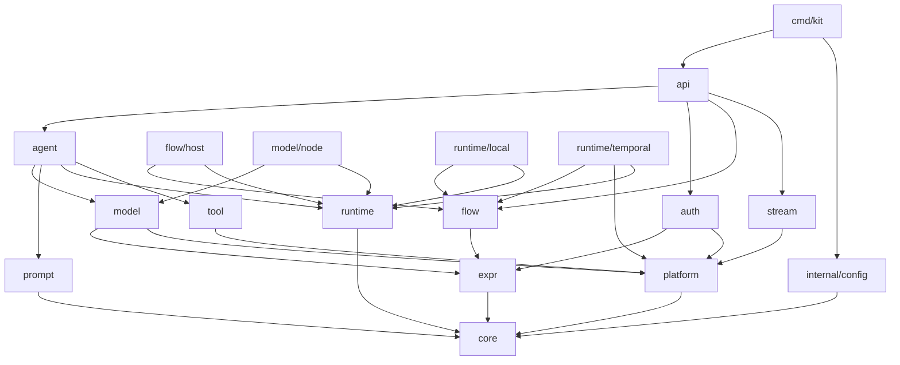

# Architecture overview

Basamento is a foundation for agent and flow orchestration in Go. Products
built on it include AI media production pipelines, business-app code
generation and interactive narrative. Products and presets ship as their own
binaries, each from its own Go module, importing Basamento; they are not part
of `kit`. Status words: **Implemented**,
**Planned** (see `docs/roadmap/`).

## 1. Shape

- **One binary, pure Go** (`CGO_ENABLED=0`). The **embedded profile** runs
  everything in one process for self-hosting and single-user daily use.
  The **cloud profile** swaps each port to a managed service for SaaS (ADR-0001, ADR-0004).
- **Flows are data.** A flow is a content-addressed IR of nodes and edges
  with CEL conditions, interpreted by a pure state machine (ADR-0003).
- **Runtime-neutral durability.** Flow code runs on `runtime.DurableContext`.
  Implementations: `local` (tests, CLI), `temporal` (embedded server on
  SQLite, or Temporal Cloud or a cluster) (ADR-0002).
- **Runs outlive connections.** Durable events are stored in SQL and relayed to a
  bus. Deltas are bus-only. Clients reattach with a cursor (ADR-0005).
- **One model contract.** Every model call (chat, embeddings, image, video,
  audio) is an invocation: start, events, result, cancel, lookup, plus a blocking
  form. Providers are generic HTTP API and CLI adapters configured per vendor.
  Paid starts are idempotent and budgeted (ADR-0006).
- **Workers.** The same binary runs as `kit worker` on any machine, declares
  the models and tools it serves and pulls only that work. The platform
  orders the queue, and can start workers on demand (ADR-0012).

## 2. Profiles

| Port | Embedded (OSS) | Cloud (SaaS) | Library |
| --- | --- | --- | --- |
| Durable runtime | Temporal server in-process, file-backed SQLite | Temporal Cloud or a self-hosted cluster on Postgres | `go.temporal.io/server`, `go.temporal.io/sdk` |
| SQL | SQLite (`modernc.org/sqlite`) | Postgres (`pgx`) | goose migrations |
| Blob | local directory | S3, GCS, Azure | `gocloud.dev/blob` |
| Bus + KV | `nats-server` in-process with JetStream | NATS cluster | `nats-server`, `nats.go` |
| Secrets (key wrapping) | local key | KMS or Vault Transit (`hashivault://`; refused at open until ADR-0017's driver) | `gocloud.dev/secrets` + Tink (+ our Transit keeper) |
| Credentials (the vault) | SQL rows, envelope-encrypted | the same, or HashiCorp Vault or a cloud secret manager | own `Credentials` port |
| Audit | SQLite, append-only table, tenant-scoped reads | Postgres | `Audit` port over SQL; one store for every producer |
| Identity | none (loopback) or local accounts | OIDC (Logto or any issuer) | `golang-jwt/jwt/v5`, `go-webauthn` |
| Telemetry | slog + OTel spans to SQLite for the inspector | OTLP | `opentelemetry-go` |

Ports are selected by URL in configuration (see `platform/platform.go`).

## 3. Layers

`layering.yaml` is canonical and enforced by `go tool gate layering`. The
checker reads every direct import in production files, tests (`_test.go`),
and build-excluded sources the active tags omit, so the result does not depend
on GOOS or build tags on the host (`ADR-0018`). Every `deny_external` and
`test_only_allowed_from` key must name a layer in the same file. The module
map below is generated from it (an arrow means "may import"; arrows implied by
longer paths are omitted). Build tooling (`tools/gate`, `internal/gate`,
`internal/bdd`) is not shown; other product layers under `internal/` appear
when the graph names them.

<!-- BEGIN GENERATED: modules (go tool gate docs -write) -->

<!-- END GENERATED: modules -->

| Package | Role |
| --- | --- |
| `core` | ids, clock, error taxonomy, the tenant context (`core.TenantFrom`), canonical JSON and JSON Schema (`core/schema`). `core/coretest` fakes are test-only. **Implemented.** |
| `platform` | Infrastructure ports and their embedded/cloud implementations. |
| `expr` | CEL environment (deterministic, cost-limited, type-checked) and gojq mappings. |
| `model` | The invocation contract, providers, routing, metering. Imports no runtime. Contract and adapters **implemented** (WP-L3-01); providers and routing **implemented** (WP-L3-04). |
| `model/catalog` | Descriptors by model id, and the shipped, deployment and tenant price layers with the default token formula. **Implemented** (WP-L3-06). |
| `model/node` | The `model` node handler: the flow code and steps that reserve, start, wait and settle (ADR-0011). **Implemented** (WP-L3-03). |
| `prompt` | Versioned templates, segment assembly, untrusted wrapping, lint. |
| `flow` | IR, compiler, builder and the pure `Machine`. Imports no runtime. |
| `flow/host` | The generic flow host (a `runtime.FlowHost`): drives the machine through `DurableContext` and dispatches node handlers (ADR-0011). |
| `runtime` | `DurableContext` and `Runtime` contracts; `local` and `temporal`. |
| `stream` | Durable event log, deltas, snapshots, cursors. |
| `agent`, `tool` | Bounded tool loop, conversations, tools, MCP, sandboxes. |
| `auth` | Authentication modes and in-app authorization. |
| `api` | connect-go services, SSE/WebSocket streams, OpenAI-compatible model endpoint, MCP server. |
| `cmd/kit` | The `kit` binary: commands, composition root, `serve` lifecycle. |
| `internal/config` | Load, validate and report kit configuration; imports `core` only (ADR-0016). |

### Security in the contracts

Three rules hold across the ports that touch tenant data; the doc comments in
`core/tenant.go` and `platform/platform.go` are the contract (ADR-0004,
ADR-0012 §10, constitution §7–8).

- **The tenant comes from the context, only.** Callers set it with
  `core.WithTenant` and read it with `core.TenantFrom`, which reports a nil
  context, no id, or an id outside the tenant id grammar (`REQ-CORE-005`) as
  tenantless. A port that needs a tenant fails closed
  with `invalid_argument` when there is none; nothing falls back to an empty
  or default tenant.
- **Credentials.** The vault stores named secrets per tenant, reached only by
  the reference `cred://<name>`. Names are 1 to 128 characters from A–Z,
  a–z, 0–9, `.`, `_`, `-` and `/`, made of `/`-separated segments none of
  which is empty, `.` or `..`; equivalently, with the length limit checked
  separately, they match
  `^(?:[A-Za-z0-9_-][A-Za-z0-9._-]*|\.(?:[A-Za-z0-9_-]|[A-Za-z0-9._-]{2,}))(?:/(?:[A-Za-z0-9_-][A-Za-z0-9._-]*|\.(?:[A-Za-z0-9_-]|[A-Za-z0-9._-]{2,})))*$`.
  A name cannot walk the store key (`<prefix>/<tenant>/<name>`, ADR-0004) out
  of its tenant's entries or carry query, fragment or control characters
  into an error or an audit event; an invalid name is rejected without being
  echoed. `Resolve` records the use through `Audit` before it returns the
  value, and returns `unavailable` with no value if the record fails.
- **Audit.** One append-only store for every producer. An event's tenant is
  the context's; `Record` rejects an event whose tenant disagrees with the
  context, and a producer with no tenant cannot write under one. Events with
  no tenant are **deployment-level**: refused joins with an unknown pool
  token (REQ-MODEL-029), shared-pool and launch events, and operator actions.
  They belong to the deployment and tenant-scoped reads never return them.
  An event carries IDs, never a secret or a raw token.

## 4. Where to read more

| Topic | Document | ADR |
| --- | --- | --- |
| Runtimes and the durable contract | [`runtime.md`](runtime.md) | 0002 |
| Flow IR, compiler, machine, host | [`flow-engine.md`](flow-engine.md) | 0003, 0011 |
| Streaming and reattach | [`streaming.md`](streaming.md) | 0005, 0007 |
| Model layer, prices, workers | [`model-layer.md`](model-layer.md) | 0006, 0012 |
| Auth | [`auth.md`](auth.md) | 0008 |
| Browser runner | [`browser-runner.md`](browser-runner.md) | 0009 |
| How it compares with LangGraph, Dify and others | [`comparison.md`](comparison.md) | |
| Specs and the gate | [`../engineering/bdd-convention.md`](../engineering/bdd-convention.md) | 0010 |

## 5. Prior art and dependencies

We reuse rather than reinvent. Notable choices:

- **Eino** (`cloudwego/eino`): message and tool schema, provider adapters
  (OpenAI, Anthropic, Gemini, DeepSeek, Qwen, Ark/Doubao, Qianfan, Ollama, OpenRouter). Its graph runtime
  and ADK agents are not used, because they are not deterministic as workflow code
  and cannot be stepped from outside.
- **Google ADK Go** and Temporal's ADK integration: a reference for workflow
  agents. Our agent loop stays runtime-neutral (ADR-0002).
- **cel-go** (`cel.dev/cel-go`), **gojq**, **godog**, **MCP Go SDK**,
  **connect-go**, **gocloud.dev**, **nats-server**.
