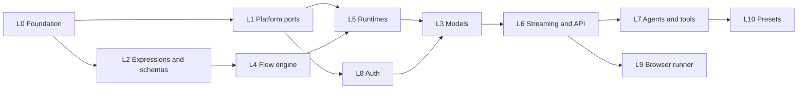
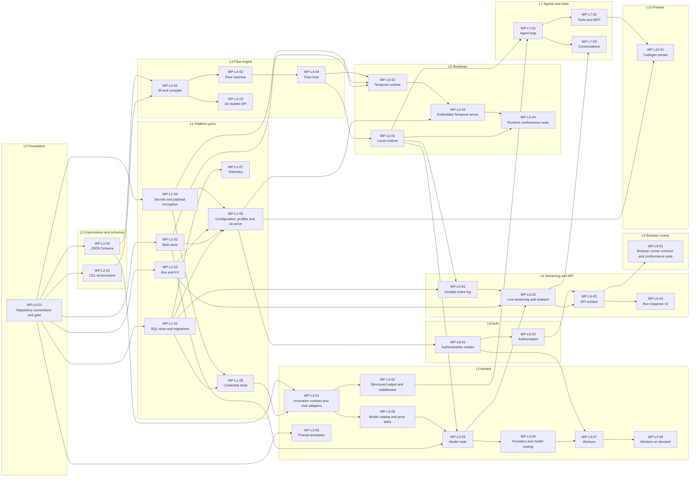

# Roadmap

Work is organized in three levels, so the roadmap stays readable as it grows:

| Level | Where | Example |
| --- | --- | --- |
| **Epic** | One file here, `L<n>-<name>.md` | `L3-models.md` |
| **Work package (WP)** | A `### WP-L<n>-<NN> — title` section in its epic file, with `Depends:` and `Owns:` lines | `WP-L3-04 — Providers and model routing` |
| **Task** | A piece of a WP small enough for one change (one vendor manifest, one adapter, one migration); a sub-issue where a tracker is used | "Seedance manifest and simulator" |

- These files hold definitions only. Status is derived, never written:
  `go tool gate wp` shows each WP as done (its scenarios are all active),
  in progress (a session holds it), ready or blocked. Agents coordinate as
  described in `docs/engineering/agent-workflow.md` §3.
- `@wp:WP-…` tags in `specs/` must name a WP defined here (`gate spec lint`).
- Besides the directories on its `Owns:` line, every WP owns its scenarios
  under `specs/<capability>/` and its step file in `internal/bdd/steps/`.
  Two WPs may own overlapping directories only when one depends on the other,
  so they never run in parallel (`gate docs` checks it).
- A WP may start when its dependencies are done. A WP carries a
  `@level:system` scenario only if it depends, directly or not, on `kit serve`
  (WP-L1-05), and on the API (WP-L6-03) when the scenario goes through it. WPs run in parallel when
  their owned directories do not overlap.
- When a WP grows too large for one change, split it into new WPs in the same
  epic (next free number), or into tasks when the pieces share one spec.

The diagrams below are generated from the epic files; refresh them with
`go tool gate docs -write`. The gate fails when they are out of date.

## Epics

<!-- BEGIN GENERATED: epics (go tool gate docs -write) -->

<!-- END GENERATED: epics -->

## Work packages

<!-- BEGIN GENERATED: work-packages (go tool gate docs -write) -->

<!-- END GENERATED: work-packages -->
